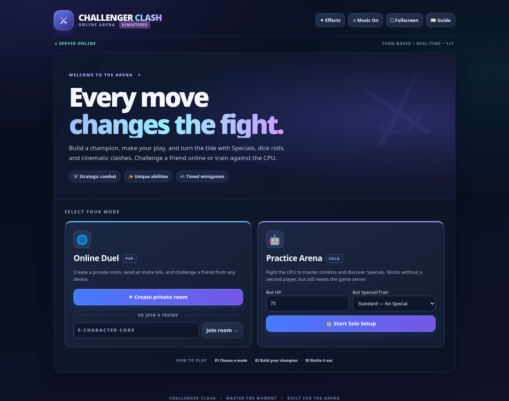

# ⚔️ Challenger Clash — Online Arena

A real-time, **1v1 turn-based browser fighting game** with dice-driven combat, custom champions, outrageous abilities, and arcade-style timing challenges. Create a private room to fight a friend or practice against the CPU. Built with **Node.js, Express, and Socket.IO**; no frontend build tool is required.

## Rival Circuit edition

Choose **Enter the circuit**, lock in your champion and start the battle. Beat Knuckle (60 HP), Bulwark (80 HP) and Flux (100 HP) in order. Each has a different move preference. After a win, choose **Face** to advance at full health. After a loss, retry the same duel. Circuit progress belongs to the current room.

**Strike Lab** is an eight-strike timing drill with combo scoring and a personal best stored on this browser when storage is available. Open it from the arena or double-click `public/strike-lab.html` for offline play. Online duel results now show the score across rematches with the same opponent.

To run the full game locally, install Node.js 20 or newer, extract the project, then run `npm ci` and `npm start` from its folder. Open http://localhost:3000.



> This is a major presentation, stability, and developer-experience upgrade of Challenger Clash v52. The original combat systems and special abilities are retained. Detailed development history is in [CHANGELOG.md](CHANGELOG.md).

## November 5, 2026 — Reality Clash, Crowd Hype and Team Rocket

This release preserves the existing multiplayer game and adds a skill-based answer to **The Great Exception's Reality Manipulation Ultimate**. Both players now share a four-pulse **Reality Clash** overlay. The Ultimate owner selects one rewrite (HP damage, Momentum/Hype drain, or a temporary basic-button seal), while both players time four pulses. Better resistance reduces the rewrite but can never cancel it outright. Attack-side wins deal 22 HP / drain 50 charge / seal 3 target turns; ties deal 16 HP / drain 35 charge / seal 2 turns; defender-side wins still deal 10 HP / drain 20 charge / seal 1 turn. HP removal is nonlethal. An upgraded Magic Bag is still granted for the next two personal turns. The old **permanent button deletion** is removed.

**Smooth Criminal** now has slightly wider zones (Green ±5.5°, Gold ±1.2°). Damage is rounded up from Green seconds plus three times Gold seconds; Gold is already included in Green, meaning a second in Gold is worth **four damage in total**, twice the previous Gold value. The 5-second Gold reward remains unchanged. **Beat It** deals one less base damage. The Gloved One's positive Hype gain is reduced by 33% when beginning at 60+ Hype; having 50–74, 75–99, or 100 Hype makes incoming direct attacks deal +1, +2, or +3 damage respectively.

**Pokémon Trainer:** successive moves from the same Pokémon cost **one extra PP** (not an indefinitely growing penalty) until a different Pokémon actually uses a move; switching without attacking cannot reset the tax. **Team Rocket** may steal a currently eligible damaging Special, opponent-debuffing Effect, Pokémon move, or eligible item/companion Special such as Magic Bag. The original owner is blocked from the exact stolen move for the theft duration. The Ultimate's cinematic and full Pokémon HP/PP restoration are preserved.

**The Great Exception's damaging items** (including items from Magic Bag and the Shop) grant **5–15 extra Momentum** on actual HP damage dealt: `min(15, 5 + round(HP damage / 2))`. Blocked or missed attacks award no item Momentum. This is a direct grant, not multiplied again by the character's general Momentum modifier.

For the exact upload list and deployment checks, see [`UPDATE-NOV05.md`](UPDATE-NOV05.md). Full live two-player Railway testing is still recommended after deployment.

## ✨ November 2, 2026 — Judas, Great Exception, Pokémon and Gloved One

This update preserves the original 1v1 multiplayer game and previous content. **All changed rules are server-authoritative.**

- **Blue Judas:** regenerates **+1 CE per personal turn** outside Six Eyes (+5 during Six Eyes). Limitless Blue and Max Blue use a fast **3-second** Gravity Control challenge with drifting objects: three for Blue, **six for Max Blue**. Max Red plays the same red-orb timing challenge as Limitless Red. The regular Blue and Red attacks deal **4 less base damage**; Max variants preserve their enhanced baseline. Infinity reaction timing has been tightened without being as strict as ordinary Parry.
- **Red Judas:** Dismantle and Fuga use only **five glyph types**. Successful symbol positions still contribute damage if the timer runs out; Red's damaging Specials **have no individual cooldowns** (their energy costs remain). Judas can now also convert **1 Positive Energy → 2 Cursed Energy**, without using a combat action, if the shared bar has space.
- **Effects:** pressing the main Effects button has **no global cooldown**; individual effects keep their cooldowns. Time-limited effects applied from the Effects menu last **one additional affected turn**. All recurring status damage, including Burn/Bleed/Poison/Shock, has **+2 damage per tick**; damaging effect combinations also have +2.
- **Great Exception:** Magic Bag adds **Kite** (10 damage, Windblown), **Penguin** (12 damage, Distracted), and **Magic Mirror** (reflect up to 10 HP damage from next attack). Offensive bag items gain **+2 damage**. Umbrella is now a four-gust direction minigame with **2-turn cooldown**, Miss/Good/Perfect granting **25%/60%/80%** protection on the next incoming attack; Perfect counters for 6 damage. During the enhanced Bag state, Perfect protection is **100%**. Unused protection expires after the opponent's next action.
- **Pokémon Trainer:** Team Rocket's original cinematic and full-team HP/PP recovery remain, but it now **steals one random enemy Special Attack** for **three turns**. The stolen attack is temporarily unavailable to its owner and appears on the Trainer's **Ultimate** button. The earlier blanket Special/Ultimate lock is removed.
- **The Gloved One:** now uses **Crowd Hype** for up to +3 damage to attacks. Beat It is a ten-note accelerating rhythm minigame, Moonwalk is a five-prompt opposite-arrow challenge, Pitching the Voice uses the letter minigame, Smooth Criminal is a native balance game, and Light-Up Footwork is a 3×3 memory challenge.

The new games appear as arena overlays on desktop and mobile. **Deploy the new `server.js`, `public/index.html`, `public/casino-judas.css`, and `casino-judas-rules.js` together**. Keep `gambler-rules.js` and the existing Dockerfile in your repository. See [UPDATE-NOV02.md](UPDATE-NOV02.md).

## 🐍 Master of Presentation expansion — November 1, 2026

The same existing multiplayer fighter now has two temporary equipment branches. All damage and equipment costs are resolved by the server, and minigames appear as full-screen overlays on desktop and mobile.

- **Black Mamba Armor:** costs **15 Momentum**, grants **10–15 stored Defence** (normal cap: 20) for the next 3 personal turns and temporarily unlocks **Mamba Strike** (damage zones **5 / 10 / 13 / 17**) and **Targeting Systems** (tap widely separated targets within **3 seconds**; deals **4 damage + 3 per target**).
- **Spider Bot:** costs **10 Momentum**, grants **5 Defence**, and provides **one 25% dodge check** against the next incoming damaging attack. While active for the next 3 personal turns, it unlocks **Electricity Turret** and **Music Speakers**.
- **Electricity Turret:** a 15-invader arcade shooter. Move with **WASD**, fire with **Space**, or use the on-screen mobile controls. Deals **5 damage + 1 per invader destroyed**. The server validates ship movement, shot timing and available targets.
- **Music Speakers:** applies **Groovin** to the opponent for their next **3 personal turns**, randomly disabling one available main action button each turn. The server rejects blocked moves, not just the interface.
- New UI stylesheet: **`public/presentation-minigames.css`**. It must be added alongside the changed `server.js` and `public/index.html` during GitHub updates. See `UPDATE-PRESENTATION.md`.

## 🎮 October 30 gameplay, balance & Pokémon Trainer update

This is a direct update to the **same online 1v1 fighting game**. All outcomes and costs are enforced by the multiplayer server.

- **Dismantle:** Red Judas memorizes 5 symbols drawn from **5** possibilities for **3.5 seconds**, then inputs them within 4 seconds. Each correctly placed symbol counts even if others are wrong; 1/2/3/4/5 correct awards **3/5/8/12/15 damage**. **Cleave** now displays clear HIT and MISS feedback. **King of Curses** regenerates **5 Cursed Energy** per turn while active.
- **Judas energy:** Positive Energy can be gained **only** by converting 3 Cursed Energy into 1 Positive Energy, without spending the move. After Six Eyes or King of Curses expires, the shared capacity returns to **8** and **all stored Cursed and Positive Energy are reset to 0**.
- **Momentum:** damaging Specials grant a base **+7 Momentum**, processed through the existing global champion modifiers (0.75 for most champions, 1.15 for The Great Exception). Heavy Attacks grant **5 less base Momentum** than previously. Energy Charge grants **7 base Momentum**.
- **Standard combat:** Normal Attack rolls **3–5 base damage**, plus timing. Guard grants **4–6 Defence**. The new **Defensive Stance** grants 2–3 Defence **once during your current turn without using the main move**, with **−3 damage** on your subsequent damaging moves that turn. **Armour Break** destroys 75% of current stored Defence and prevents Defence-menu moves during the victim's next turn. The Effect menu now includes a plain-language effects glossary.
- **Items and interface:** National Flag grants **25 Momentum**, maximum **two uses per player per match**; the Shop shows **four randomly offered items** at a time, refreshing after purchases. Ready-to-activate **Six Eyes** and **King of Curses** buttons glow gold.
- **Pokémon Trainer:** choose your opening Pokémon once, and choose again only after it faints. Switch freely through **Pokémon Moves**, without spending your turn. PokéCenter PP recovery now requires selecting **two different Pokémon** and restores 1 PP to each selected Pokémon's moves. Charizard has **1 PP per move**, and Pikachu's Volt Tackle causes **5 HP recoil**. Ultimate **Team Rocket** now plays the supplied video with replacement audio, temporarily steals one randomly chosen opponent Special Attack for **three** turns, and restores every Pokémon (including fainted and benched Pokémon) to full HP and PP.

The cinematic file is served as `public/video/team-rocket-ultimate.mp4` and is automatically copied by the existing Dockerfile's `COPY public ./public`. The animation uses the supplied video and replacement sound; if unmuted autoplay is blocked by the browser, players can tap to hear it.

**Compatibility:** The Dockerfile still copies both `gambler-rules.js` and `casino-judas-rules.js`. Do not delete either file. See [UPDATE-OCT30.md](UPDATE-OCT30.md) for uploading into your GitHub/Railway deployment.

## 🔴 Red Judas revamp + combat balance (2026-10-29)

- **Dismantle** (4 Cursed Energy, 3-turn cooldown): five symbols from a pool of seven are shown for 3.5 seconds; you have 4 seconds to repeat the order. Correct symbols (in the right position) award 3 / 5 / 8 / 12 / 15 damage for 1–5 matches. Four or five matches apply **Scored**; the next Cleave consumes it for +3 damage.
- **Cleave** (2 Positive Energy, 3-turn cooldown): three reactive slash inputs on ONE accelerating bar. Hit zero, one, two or three to deal 2 / 5 / 7 / 10 damage. Two or three hits apply Bleed. The third slash has a deliberate fake-out pause.
- **King of Curses** unlocks the existing Binding Vows and **Fuga** (10 Cursed + 2 Positive Energy, 5-turn cooldown). Fuga flashes five distinct fire symbols in order; repeat them for 3 / 5 / 7 / 10 / 15 / 20 damage on zero–five matches. Successful attempts also cause Burn ×2 (6 instead of 3 per tick) for 2 turns.
- **Reverse Cursed Technique** now costs **4 Positive Energy** for **both Judas champions** and restores 7 HP now plus 7 on each of the next two turns.
- **Domain Expansion M.S.** now has the same 3-turn charge (−4 CE each personal turn, regular moves still allowed) or 15-CE next-turn shortcut as I.V., including opponent Domain Clash choices. On each of the victim’s next four turns, M.S. deals 5 Domain damage and reapplies Bleed (which also ticks normally).
- **Infinity** has a success window HALF as wide as before. Hollow Purple gains **+3 damage per stored Blue Charge and per stored Red Charge** (charges are not consumed by the Ultimate). Gravity Control has a clearer live countdown and exactly 6 playable seconds.
- **All positive Momentum gains** are multiplied by **0.75**, rounded to the nearest whole Momentum point (at least 1 for positive gains), except **The Great Exception**, whose gains are multiplied by **1.15**. Spending, drains and fixed failure refunds are unchanged. The Charge menu shows the updated gains.

These changes retain the existing online 1v1 battle format and earlier Gambler updates. All minigames are fullscreen overlays over the battlefield; combat outcomes are validated by the server.

## ⚔️ Combat content update — Energy Charge choices, effects and stats

The original 1v1 online game remains the same. The **Charge** button now offers three choices after Energy Charge completes: **Prepare Beam** (−15 Momentum and original preparation turn), **Unstable Beam** (−10 Momentum, D12 +6 immediately, 5 recoil), and **Charged Attack** (moved here from Attack; base +10 Momentum (now +8 after the global Momentum adjustment)). Beam Clash, server-controlled dice, and original Specials/Ultimates still work.

**New Effects:** Energy Leak removes 8 Momentum on each of the opponent’s next two turns. Adrenaline grants +3 to the next Normal/Heavy/Charged strike at the cost of 2 recoil if it wounds HP. Both have individual cooldowns and the normal Effects-button cooldown.

**Effect combinations:** Wet + Shock = Conductive (2 bonus damage once); Burn + Poison = Toxic Flames (3 damage, consumes Burn); Weakness + Heavy Attack = Crushing Blow (+3 damage, consumes Weakness); Armour Break + Charged Attack = Shattered Armour (breaks up to 3 Defence, consumes Armour Break).

**Battle polish:** all active cooldowns appear near the battle buttons, natural critical hits are emphasized with gold visuals and sound, and post-battle match statistics compare both fighters. See [UPDATE-TO-GITHUB.md](UPDATE-TO-GITHUB.md) for the exact files to replace in your existing GitHub repository.

## 🎬 Animated Gambler minigames (2026-10-28)

The Gambler's existing rules now have **full visual minigames**, not plain text outcomes. **Blackjack Bash** opens a casino-felt dealer table with individually dealt cards, hand scores, Hit / Stand / Split / Double Down / Surrender controls, a live decision timer and an animated dealer reveal. **Poker Table** uses a heads-up Texas Hold'em table with private hole cards, animated community-card reveals, selectable damage wagers, Call / Check / Raise / Fold buttons and a showdown scene. Folding **does not reveal** private hole cards. **Relentless Gambler** uses a three-reel slot-machine cabinet, with real reel animation and staggered stops approximately one second apart, followed by a JACKPOTT celebration. **Double or Nothing** now shows a full-screen flipping coin with the server's actual result.

The multiplayer server still decides cards, flips, slot symbols and damage, and sends shared outcome events. The new presentation stylesheet is `public/gambler-minigames.css` and **must be uploaded** alongside `public/index.html` and `server.js`. No new npm dependencies, modes, accounts, or gameplay systems were added. See `GAMBLER-ANIMATED-UPDATE.md` for update steps. Reduced-motion preferences are respected.

## 🎰 New champion: The Gambler (2026-10-28)

Select **🎰 The Gambler** under **Fun** in champion setup. This is an additional fighter in the existing 1v1 multiplayer game, not a separate mode.

| Ability | Rules |
| --- | --- |
| **Bad Luck** (Effect) | Enemy's next attack/Defence die is rolled twice; the lower die counts. 3-turn personal cooldown. |
| **Fortune** (Effect) | Your next attack/Defence die is rolled twice; the higher die counts. 3-turn personal cooldown. |
| **Blackjack Bash** (Special) | Play blackjack against the server dealer: Hit, Stand, Split equal-value cards, Double Down, or Surrender. Win: 5–10 damage based on your total; a two-card natural blackjack beats the dealer for **15**; losing or busting costs enemy 2 damage rather than winning damage. Split hands score independently: only winning hands contribute, with a minimum 2 consolation damage if both lose. 1-turn cooldown. Dealer follows hit-under-17 rule. Double Down adds 50% to a winning hand. |
| **Poker Table** (Special) | Both real players receive two private hole cards and share a Texas Hold’em board. Bet/raise, call, check or fold at any time. Each player’s **total damage wager is capped at 20**. The winning hand deals the winner's damage wager minus the losing hand's protection (up to 7); ties deal no damage. If the challenged opponent folds, they take the Gambler's full wager; if the Gambler folds, they take half the opponent's wager (rounded up). Winning at showdown grants a one-attack bonus based on hand rank: **Pair +1 up to Royal Flush +10**. Per the requested rule, a High Card win also awards +10. 2-turn cooldown. |
| **Double or Nothing** (Special) | Arm your next attack, then elect to flip a server-controlled fair coin **up to three times**. Each Heads multiplies the damage by **1.5** (maximum ×3.375); you can cash out after any success. Any Tails sets the next attack to **0 damage**. Animated coin result; 3-turn cooldown. |
| **Relentless Gambler** (Ultimate) | Spend 100 Momentum to start a five-personal-turn domain charge. On each of those turns, roll a server-controlled slot machine instead of the usual Defence phase. No matches: D4 attack; two matching symbols: D6 attack; three matches: **JACKPOTT**. The enemy can interrupt the charge after dealing **40 cumulative HP damage** during charging. |
| **JACKPOTT** | **Invincible, +5 damage to attacks, no Momentum gain** for the next 4 personal turns. During this window, use **JACKPOTTT** once to regenerate 7 HP on each remaining active turn, and use **Dance Battle** once. Three 7s or any triple at or below 15% HP gives **+25 Momentum** and +1 JACKPOTT turn; three 7s at or below 15 absolute HP adds one more turn. |

Poker hole cards are transmitted to each player privately. Cards, casino results, wagering, and slot spins are decided/validated by the server, never trusted from the browser. Blackjack and poker decisions have a 50-second inactivity timeout to prevent locked matches. See [UPDATE-TO-GITHUB.md](UPDATE-TO-GITHUB.md) for only the files you need to upload.

## ✨ What's inside

- **Two ways to play:** online PvP with a five-character room code, or single-player vs CPU.
- **Champion creator:** choose a name, 50–100 starting HP (or roll), and a Special/Trait. There's also a **Surprise Me** quick-pick.
- **Combat depth:** attacks, Defence, effects, buffs, Momentum, Beams, timed clashes, Specials and Ultimates.
- **Special champion kits:** Berserker, Iron Wall, Arcane Surge, Trickster, Nightcrawler, Blue Judas, Red Judas, The Great Exception, The Gloved One, Master of Presentation, Pokémon Trainer, and The Gambler.
- **Action minigames:** Strike Timing, Parry, Beam Clash, Domain Clash, Dance Battle, Moon Walk, Beat It, and more.
- **Realtime rooms:** chat, server-controlled HP/dice/turns, seat recovery after refresh, room invite links, and rematches.
- **Quality-of-life:** redesigned responsive arena, clear turn guidance, keyboard shortcuts, separate sound and reduced-motion settings, progress indicators, win-by-surrender and disconnected-player forfeit protection.
- **Deploy-ready:** `/health` check, `.env.example`, Render blueprint, Dockerfile, and GitHub Actions smoke tests.

## 🚀 Run it locally

Install **Node.js 20 or newer** and run from the project root:

```bash
npm install
npm start
```

Open **http://localhost:3000**. To test PvP, open the site in two separate browser profiles (a normal and an incognito profile also work). Create a room in one and join from the other.

For automatically restarting your server while developing:

```bash
npm run dev
```

## 🌍 Put it on GitHub and make it playable online

**GitHub stores the code. GitHub Pages alone cannot run this game** because multiplayer requires a continuously running Node.js / Socket.IO server.

1. Create an empty GitHub repository.
2. Upload all project contents, including the `.github` folder, `public`, `server.js`, `package.json`, and `render.yaml`. **Upload the extracted files, not the ZIP itself.**
3. For a public live game, choose one of the options below and connect the GitHub repository.
4. When deployment finishes, open the live HTTPS address. Create a room and share its **Share invite** link.

### Deploy on Render (blueprint)

1. Go to [Render](https://render.com) and connect your GitHub account.
2. Choose **New → Blueprint** and select your game repository.
3. Render will read `render.yaml` and create a Node web service.
4. Deploy and use the assigned public URL. The health endpoint is `/health`.

Render's free services may sleep during inactivity and take some time to wake. Restarts erase active battles because room state is stored in memory.

### Deploy on Railway

1. Create a Railway project from your GitHub repository.
2. Railway should detect Node.js automatically; set `npm start` as the start command if needed.
3. Generate a public domain in the service networking settings.
4. Open that URL in two different browsers to try online matchmaking.

### Docker

```bash
docker build -t challenger-clash .
docker run --rm -p 3000:3000 challenger-clash
```

One running server instance must own each active room. **Do not run multiple uncoordinated replicas** without adding a Socket.IO adapter and shared room state.

Note: a local `.env` file is not automatically loaded by Node.js. Set environment variables in your hosting dashboard or terminal.

## 🎮 Quick controls

| Control | Use |
|---|---|
| Click/tap an action or press `1`–`7` | Open battle actions (only on your turn) |
| `Space` / tap **HIT** | Strike Timing, Parry, many reaction minigames |
| `A` / `D` | Player 1 / Player 2 Beam Clash |
| `1`–`4` | Domain Clash prompts |
| Arrow keys or on-screen arrows | Dance Battle / Moon Walk |
| Shown letters | Beat It |
| **Guide** | Full in-game rules and tutorial popups |
| **Effects** | Reduce visual animation; respects OS reduced-motion preference |
| **Music** | Toggle the synthesized soundtrack |

**Online battle flow:** create room → send code/invite → both players customize and lock in → host starts → battle until someone wins, surrenders, or ends without a winner → rematch or return to champion select.

**Reconnect:** refreshing a tab or briefly losing internet automatically recovers your seat through a private browser token. Don't use the same browser profile to play as both players. Only room codes—not private seat tokens—go in invite links.

**Disconnect forfeit:** when an opponent disconnects in an active online match, they get **90 seconds** to rejoin before you can choose **Claim victory**. Losing connection never triggers an instant forfeit.

## 🔧 Environment / commands

| Variable | Default | Description |
|---|---|---|
| `PORT` | `3000` | Web server port; hosting providers usually set it automatically |
| `MAX_ACTIVE_ROOMS` | `300` | Limit on simultaneously stored game rooms |
| `NODE_ENV` | unset | Set to `production` for deployment |

```bash
npm run check  # Syntax-check server and integration test file
npm test       # Online room / bot / reconnect / surrender integration tests
```

The tests use `socket.io-client` as a development dependency. GitHub Actions installs dependencies and runs both checks on every push and pull request.

## 📁 Project structure

```text
challenger-clash/
├── public/
│   ├── index.html       # Original game, minigames, and browser client
│   ├── arena.css        # Responsive redesign + accessibility layer
│   ├── assets/          # Game artwork
│   └── audio/           # Sound effects
├── server.js            # Server-authoritative multiplayer and bot logic
├── test/server.test.js  # Integration smoke tests
├── .github/workflows/ci.yml
├── render.yaml
├── Dockerfile
├── package.json
├── CHANGELOG.md         # Full original v1-v52 development history
└── README.md
```

## ⚠️ Important limitations

**Rooms are in memory:** restarting or redeploying the server deletes active matches; there is no persistent user database, accounts, or cross-server matchmaking. Room codes are for casual private invites, not strong access control. Private reconnect tokens are saved in browser storage; anyone with that token can reclaim the seat.

**Timing and fairness:** HP, dice rolls, combat outcomes, and turn ownership are server-controlled. Some rhythm/timing inputs use client-reported positions, so a modified client could cheat at those minigames. For competitive tournaments you'd also want server-verifiable timing challenges, stronger anti-abuse controls, authentication, and persistent match history.

**Copyright:** Some characters, references, art, and audio may involve third-party intellectual property. **Review the rights and permissions for all included assets and references before releasing publicly.** The repository does not assert ownership or grant third-party licenses.

## ❤️ Keep building

The code intentionally preserves the large existing ruleset. Future steps could include match replays, spectator mode, player cosmetics, accessibility-focused alternatives to reflex minigames, a shared persistent room store, more CPU strategies, and matchmaking.


### Gambler Overlay & Luck Update
The Gambler's Blackjack, Poker and Slot minigames are screen overlays, so the casino is presented on top of the fight. The stage resizes to the available viewport and scrolls internally only on exceptionally short screens. Dance Battle notes accelerate progressively to 175ms. Failed Relentless Gambler runs refund 100% Momentum; each unmatched spin adds 3 percentage points (max 30%) to the chance of a triple on subsequent rolls, cleared by JACKPOTT. A Domain Clash victory with Relentless Gambler or a successful 50%-chance Gambler revival guarantees three sevens on the next Slot spin.

## October 2026: Fortune Roulette and Judas energy

The Gambler now has animated **Fortune Roulette** on the Special menu. It uses a server-randomized single-zero (0–36) wheel with standard inside/outside betting patterns. Rare wins deal more damage; if a winning bet hits green zero, JACKPOTT activates instantly. Dance Battle begun by the Gambler deals 10 damage to the loser.

Blue Judas and Red Judas now share a purple **Cursed Energy** and blue **Positive Energy** HUD, +2 CE per own turn, +1 PE per three own turns, and a free 3 CE → 1 PE conversion from Special. Six Eyes and King of Curses now require 50 Momentum and raise energy capacity to 20. Blue Judas also has interactive Gravity Control and pulsing-sphere Limitless attacks, charge-enhanced Max Blue, temporary Pulled and Off-Balance effects, and a 7 HP × 3 pulse Reverse Cursed Technique. The pending detailed Max Red revamp and Red Judas attacks are intentionally not redesigned yet.

See [UPDATE-ROULETTE-JUDAS.md](UPDATE-ROULETTE-JUDAS.md) for detailed rules, exact GitHub update paths, and testing notes.

## Six Eyes, I.V. and Gambler balance update (October 29, 2026)

- **Six Eyes:** grants +5 Cursed Energy rather than +2 at the beginning of each Blue Judas turn while active, lasts **six complete personal turns after activation**, then enters a **seven-turn cooldown**.
- **I.V. Domain Expansion:** while Six Eyes is on, open **Special → Domain Expansion I.V.** and choose a route. **Charge Domain** spends **4 Cursed Energy on each of the following three Blue Judas turns**, but you can use your normal move those turns. The Domain activates at the start of the *next* turn. An individual 15+ HP hit still cancels charging. **Instant Domain** spends **15 Cursed Energy now** and activates at the start of your next turn if the opponent doesn't contest it.
- **Domain response:** eligible opposing Judas players see an on-screen clash-or-accept decision, resolved by the server (20-second timeout chooses accept). Players already charging a Domain can spend **5 CE** to force a clash; an uncharged eligible Judas needs **15 CE**. A clash uses the existing 1–4 timing battle. Other champions or opponents with insufficient energy cannot challenge with this new resource option.
- **Infinity:** costs **7 CE** and covers the next **three incoming attacks** with an easier version of Parry's timing minigame. Stronger incoming attacks narrow the success window. This covers standard hits and the newly added blackjack, poker, roulette, and Limitless attacks.
- **Gambler cooldowns:** Blackjack Bash **1 turn**, Poker Table **2 turns**, Fortune Roulette **1 turn**. A completed Poker hand adds **2 raw damage** to the winning wager before the losing hand's reduction and stored Defence. Fold damage is unchanged.
- **Domain Clash soundtrack:** starts for every clash, not only the Blue vs Red cinematic, with a retry on the next user interaction if browser autoplay restrictions block the first play. Music Off remains respected.

See `UPDATE-SIX-EYES.md` for GitHub and Railway deployment instructions.

### November 3 — The Gloved One: Hype tuning and native Smooth Criminal

- **Pitching the Voice:** Perfect result deals **11 base damage** instead of 13; 3-turn cooldown.
- **Moonwalk:** each opposite-arrow prompt has a **1-second** input window; the next prompt still appears immediately; 2-turn cooldown.
- **Smooth Criminal:** now renders **directly inside the standard battle minigame overlay** (no iframe or separate game window), keeping the supplied Impossible Lean's semicircular dial, moving needle, green/gold zones, A/D or arrow controls, and 10-second rules. The server still calculates Gold/Green time and rewards; the client predicts needle motion between server updates only for smooth visual feedback. Cooldown: 3 turns.
- **Crowd Hype damage tiers:** 0–24: −2, 25–49: −1, 50–74: +1, 75–99: +2, 100: +3 damage to Gloved One attacks, applied in the server's centralized damage resolver. This stacks with Feel the Flow/Thriller Night.
- **Boooo (Effects):** only available when facing The Gloved One with at least 50 Hype. Spends your move to remove **25 Hype**; 2-turn cooldown. The server checks target Hype, cooldown, and identity; it cannot be spammed.
- **The Kid Is Not My Son!:** 4-turn cooldown; original dispel behavior unchanged.

The original `public/smooth-criminal.html` is retained as an unused reference to the owner's standalone prototype. The live game now displays the native version from `public/index.html` and `public/arena.css`.

### The Gloved One — Crowd Hype revamp

The Gloved One now uses **Crowd Hype**, earned from performing dance challenges (Perfect +20 / Good +10 / Miss −5). Use **Feel the Flow** (40 Hype) to power the next attack or **The Final Show** (50 Hype) to extend Thriller Night. See `UPDATE-GLOVED-ONE.md` for the new solo Beat It, opposite-arrow Moonwalk, Pitching the Voice, Smooth Criminal, and Zombie Dancers Thriller mechanics. Audio during Thriller Night uses `public/audio/gloved-thriller-night.m4a` supplied by the project owner.

## Rhythm minigame hotfix — November 2, 2026

- **Beat It** is a ten-note, solo, four-lane falling-arrow rhythm game, with receptor-aligned notes and server-validated hits. Every successful note adds one damage and increases the tempo; a miss resets the streak and tempo. The existing one-turn cooldown is unchanged.
- **Dance Battle** now uses the same hit timestamp on the client and server, keeps its falling notes aligned with the receptors, and applies a capped 160 ms network-latency allowance. Early taps are ignored rather than charged as misses. Rapid consecutive inputs are no longer blocked by a global in-flight request flag.
- **Light-Up Footwork** gives one quiet second to get ready before the three-second memory sequence. The floor tiles remain mounted as replies arrive, so rapid taps are preserved.
- **Live countdowns** for Gloved One performances and Footwork update on animation frames instead of only when the server sends another state. The red-symbol keyboard and Gravity Control objects also remain mounted during responses.
- Added a more legible concert-stage interface, receptors, note glow, timer progress, touch-friendly controls, and feedback.

All hit judgments and damage remain server-authoritative. The limited latency allowance is not a guarantee on high-latency connections; test real matches after deployment.

### Smooth Criminal: The Impossible Lean

The Gloved One's Smooth Criminal now uses the original player-supplied balancing minigame, directly integrated into the battle minigame overlay (no iframe). Hold left/right (or A/D) to keep the needle within the **green ±4°** and **gold ±0.8°** target zones over **10 seconds**. **Damage equals the rounded-up sum of green seconds and gold seconds**, with gold counted in both. **5 seconds in gold** applies Tune Deaf, heals up to 5 HP and grants Adrenaline. The server controls the official scoring; the interface displays live feedback. See `UPDATE-SMOOTH-CRIMINAL.md`.

### November 3 gameplay adjustments

- **Moonwalk:** a new opposite-arrow prompt appears immediately after a press, so you can continue without an artificial delay.
- **Inventory item use:** free for every fighter except The Great Exception. Shop purchases still use their listed turn cost, and Great Exception Magic Bag use continues to consume a turn. Delayed item interactions return control without spending your move.
- **Electricity Turret:** 8.5-second round, 15 shots total, smaller enemy collision tolerance and a visible ammo counter. Misses cost ammunition; the challenge ends once all bullets are used.

### New item minigames (November 3)

Six additional items are available in the four-offer Shop and The Great Exception's regular Magic Bag: **Power Glove**, **Mystery Candy**, **Gambler's Coin**, **Magic 8-Ball**, **Cursed Stopwatch**, and **Deck of Cards**. Opening the Candy, 8-Ball, Stopwatch or Deck starts a centered battle minigame. Item outcomes and random card draws are controlled by the server. Stored items remain free actions for other fighters; using an item as The Great Exception still consumes a move.

- **Power Glove:** +7 on your next damaging attack, followed by 4 recoil HP.
- **Mystery Candy:** target yourself or the opponent with a random five-turn status. The possible statuses are Fortune, Bad Luck, Regeneration (+3 HP per turn), Poison, Strengthen, Weakness, Bleed, or Energy Leak.
- **Gambler's Coin:** Heads doubles the next damaging attack and grants Fortune for two turns; Tails deals 7 recoil and applies Bad Luck for two turns.
- **Magic 8-Ball:** choose one of three predictions for the opponent's next main action. Correct = 15 Defence (subject to the normal Defence cap) and 10 charge; wrong = +20% to the next incoming direct attack.
- **Cursed Stopwatch:** stop the uneven clock as close to 5.00s as you can. ±0.1s earns +25 charge; ±0.5s earns +15; otherwise +5. The Gloved One receives Crowd Hype instead of ordinary Momentum.
- **Deck of Cards:** choose one of five server-shuffled facedown cards. Number cards deal face value, Jacks 11, Queens 12, Black Kings 13, Black Aces 15. Red Kings deal 10 to you and Red Aces deal 13 to you. Black Joker deals 15, grants +50 charge and Fortune. Red Joker deals 15 to you, removes 25 charge and gives Bad Luck.

The **Umbrella** minigame now uses a storm-themed directional arena and four-gust display, but retains its prior Miss/Good/Perfect protection rules.
